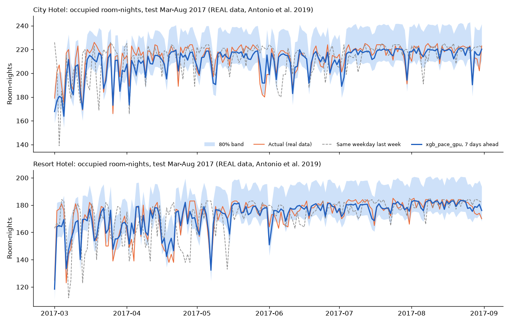

# HOI on real data: what we tested and what we learned

**Audience:** judges, mentors and the team. **Run on:** 2026-10-13/14, RTX 4050 laptop GPU.
**Reproduce:** `cd ml; python run.py realdata`. Details and method: [ml/realdata/README.md](../ml/realdata/README.md).

Our product's own numbers come from a **synthetic** hotel, because no Uttarakhand hotel has
shared data with us yet. To check that our methods are not just fitting our own simulator, we
ran them on the best **public** data we could find. Nothing on this page is synthetic. Each
dataset is labelled real, fictional or of unverified origin.

## 1. Occupancy forecasting: real bookings from two hotels

**Data (REAL).** *Hotel Booking Demand* (Antonio, Almeida & Nunes, 2019, *Data in Brief*;
CC BY 4.0). It has 119,390 real bookings from a city hotel in Lisbon and a resort hotel in the
Algarve, Portugal, for arrivals from July 2015 to August 2017. We turned the bookings into
"rooms occupied each night" for each hotel. The file does not give room counts, so we count
room-nights.

**Fair test.** The models learned from data up to October 2016. We kept two months
(December 2016 to January 2017) to choose the model. The test was the **last 6 months
(March to August 2017)**, which no model saw until the final scoring. The split is by time,
never random, with gaps between the periods.

**Results** (average error in rooms per night, test period):

| Forecast made | Hotel | Simple rule: "same weekday last week" | Our method (best, chosen before testing) | Error cut |
|---|---|---|---|---|
| 1 day ahead | Lisbon city (226 rooms seen) | off by 10.9 rooms | **off by 1.9 rooms** | -83% |
| 1 day ahead | Algarve resort (187 rooms seen) | off by 10.4 rooms | **off by 1.9 rooms** | -82% |
| 7 days ahead | Lisbon city | off by 10.9 rooms | **off by 5.3 rooms** | -51% |
| 7 days ahead | Algarve resort | off by 10.4 rooms | **off by 3.9 rooms** | -63% |
| 30 days ahead | Lisbon city | off by 18.5 rooms | **off by 7.4 rooms** | -60% |
| 30 days ahead | Algarve resort | off by 16.1 rooms | **off by 6.8 rooms** | -58% |

In percent (MAPE), the best models were wrong by 0.9-1.1% at 1 day, 2.4-2.5% at 7 days and
3.5-4.1% at 30 days. The simple rule was wrong by 5.3-9.6%. On a typical day (the median), the
7-day forecast was off by 4 rooms in the city hotel and 2-3 rooms in the resort.

**What we learned**

1. **Our approach works on real data, and works better with booking data.** Our existing
   method (gradient-boosted trees, now XGBoost trained on the GPU, with calendar, holiday and
   recent-occupancy features) beat both simple rules at every horizon in both hotels: 7.0-10.7
   rooms of error against 10.4-18.5 rooms.
   The biggest gain came from one extra input, **rooms already booked for that night
   ("on the books")**. Adding it cut the remaining error by a further 18% (resort, 30 days) to 78%
   (city, 1 day). **Product decision:** HOI must
   record when each booking was made, not only the night it is for.
2. **All model training now runs on the GPU only.** The earlier CPU LightGBM models were
   replaced by XGBoost on the GPU (within about 0.5 rooms of them); the booking-aware XGBoost
   model is now the one chosen on validation at every horizon.
3. **Google's TimesFM 2.5 is a strong "no training" model, but not the best.** Without any
   training on these hotels it beat our calendar-only model in the city hotel (7.3 vs 8.0 rooms
   at 1 day; 9.1 vs 10.7 at 30 days). It did about the same or worse in the resort. It cannot
   see the booking book, so the booking-aware models beat it clearly.
4. **Fine-tuning TimesFM on the GPU did not help.** We trained its last 4 layers (72 million
   parameters) on the GPU for about 2.2 minutes, using 3.2 GB of the 6 GB card. It improved the
   validation error only slightly (36.4 to 35.3 rooms, averaged over 1-30 days). On the test
   it was slightly worse in 5 of 6 cases (by 0.2 to 0.8 rooms; better by 0.1 in one). Two years of two hotels is too
   little data to fine-tune a 200-million-parameter model. We report this and do not use the
   fine-tuned version.
5. **Our uncertainty bands are too cautious.** The "80% range" contained the real value 91-96%
   of the time, because it was calibrated on a volatile winter period. The ranges are safe but
   wider than they need to be.

**What this could mean for a 24-room hill hotel.** Scaled by hotel size, the best 7-day
forecast was off by about 2% of the rooms. That would be about half a room for a 24-room hotel,
against about 1.2 rooms for the simple rule. **Do not expect that precision.** In a small hotel
one booking is 4% of all rooms, so day-to-day randomness is larger. A realistic expectation is
about 1-3 rooms of error, and it can only be confirmed on the hotel's own data.

## 2. Staff attrition: public HR datasets

**There is no public dataset of real hotel staff leaving.** We used the two best openly
available sets:

| Dataset | What it is | Licence |
|---|---|---|
| IBM HR Analytics (1,470 employees) | **FICTIONAL**: made up by IBM data scientists for teaching | ODbL / DbCL |
| Babushkin Employee Turnover (1,129 people) | Described by its author as **real**, but country and companies are not documented; mostly HR professionals | CC BY-NC-SA 4.0 (non-commercial: evaluation only) |

Before training we **removed age, gender, marital status, the boss's gender and personality-test
scores**, as our rules require. We compared the same model types as in HOI against a simple
"warning signs" checklist. The checklist counts overtime, low job satisfaction and poor
work-life balance for IBM, and unofficial pay and no probation coach for Babushkin.

| Dataset | Simple checklist (ROC-AUC) | Best model (ROC-AUC) | Leavers found in the top-ranked group (PR-AUC; random = base rate) |
|---|---|---|---|
| IBM (fictional) | 0.65 | **0.83** (logistic regression) | 0.61 vs 0.25 checklist (base 0.16) |
| Babushkin (real, unverified) | 0.55 | **0.65** (XGBoost) | 0.29 vs 0.17 checklist (base 0.15) |

ROC-AUC is the chance that the model ranks a random leaver above a random stayer: 0.5 is a coin
flip and 1.0 is perfect. The models' risk percentages were well calibrated: on average they were
2-4 percentage points away from what actually happened. **Lesson:** in both datasets the models
beat a fixed checklist by a clear margin, as in our synthetic tests (0.69 vs 0.54). With only
job and pay information on the real dataset the ranking is modest (0.65). Attrition prediction
should support a manager's judgement, not replace it. The plain-language rating, the tiny
hospitality subset (10 people) and why the US OPM federal data could not be used are in
[ml/realdata/attrition/VALIDATION.md](../ml/realdata/attrition/VALIDATION.md).

## 3. Proof that training used the GPU

| | |
|---|---|
| Device | NVIDIA GeForce RTX 4050 Laptop GPU, 6 GB; PyTorch 2.11.0 with bundled CUDA 12.8 |
| `nvidia-smi` before / during fine-tune (peak) / after | 77 MiB / **3,234 MiB, 97% busy** / 3,174 MiB |
| TimesFM: forecast 64 series (GPU) | 0.48 s |
| TimesFM: 3 fine-tune steps (GPU) | 0.59 s |
| XGBoost fit, 87,100 rows (GPU) | 0.63 s |
| XGBoost fit, 871 rows, the real forecast data (GPU) | 0.50 s |

Every model fit and evaluation in `ml/` now runs on the GPU only (`ml/gpu.py` refuses without
CUDA); the earlier CPU timing comparison was dropped with the CPU mode. Earlier measurements
showed the GPU matters most for TimesFM; on hotel-sized tabular data it brings no speed gain.
The deployed API still predicts on the CPU (Render has no GPU), from exported model arrays.
Full log: `ml/artifacts/realdata_gpu/real_v1/`.

## Limits

- Portuguese city and resort hotels (about 190-230 rooms, mostly foreign leisure guests, no
  monsoon or Char Dham season) are **not** Uttarakhand hill hotels. These results show that
  the methods hold up on real bookings. They do not show the accuracy HOI will reach for a
  particular hill hotel.
- The room count is not published. We assume one booking is one room.
- There is one 6-month test window and one fine-tuning run.
- Attrition: one dataset is fictional, and the other is of undocumented origin, non-commercial
  and not from hotels. Neither has dates, so we used cross-validation instead of our usual
  time split.
- Next step: run the same command on a partner hotel's export (bookings with booking dates,
  plus de-identified staff rosters) once one shares data under a data agreement.
